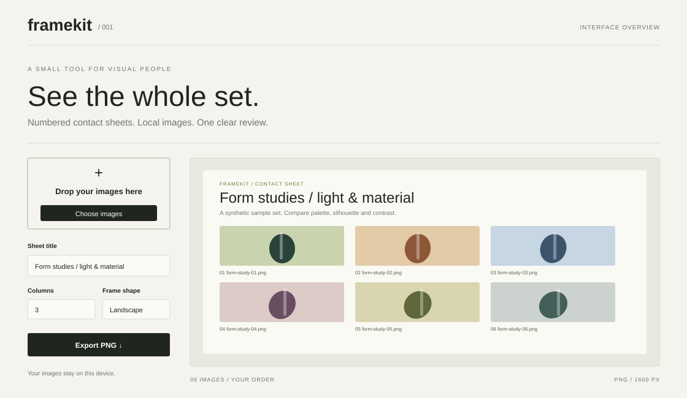
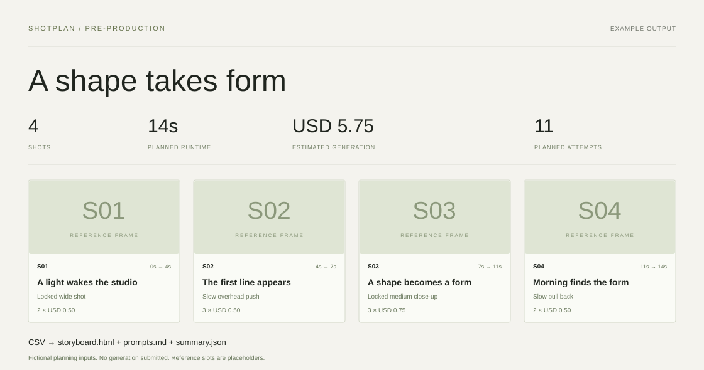

# Practical AI

**Small tools. Useful workflows.** Open working material for people who make visual things with AI.

By [satoshi 001](https://x.com/satoshiwhynot). Start with something you can try, then use the guides to take it further.

## Tools

<a href="tools/framekit"></a>

### [Framekit →](https://github.com/satoshiwhynot/framekit)

Turn image variations into a numbered contact sheet. Reorder frames, add a review note and export a PNG. Runs locally in your browser, with no upload or installation.

**Try it:** download the ZIP, open `tools/framekit/index.html` and click **Try a sample set**.

**[Open the live Framekit demo →](https://satoshiwhynot.github.io/framekit/)**

<a href="tools/shotplan"></a>

### [Shotplan →](https://github.com/satoshiwhynot/shotplan)

Compile a CSV shot list into an offline storyboard, editable prompts and a budget summary. Python standard library; no model access required.

```sh
git clone https://github.com/satoshiwhynot/practical-ai.git
cd practical-ai/tools/shotplan
python3 shotplan.py examples/film.csv --title "A shape takes form" --out build
```

Open `build/storyboard.html`. The [included example](tools/shotplan/examples/output) contains four planned shots and all three generated outputs. Example prices are fictional; the tool does not submit generation jobs.

## Work through an example

| Start with | Inspect the result | What it teaches |
| --- | --- | --- |
| [Four-shot film plan](tools/shotplan/examples/film.csv) | [Storyboard, prompts and budget](tools/shotplan/examples/output) | Turn a creative idea into a reviewable production plan |
| [Framekit product facts](workflows/content-studio/examples/framekit-launch.md#source-brief) | [Launch drafts and claim review](workflows/content-studio/examples/framekit-launch.md#drafts) | Write from inspectable features, without inventing performance results |
| [Two conflicting newsletter sources](workflows/second-brain/starter-vault/sources) | [Completed project memory](workflows/second-brain/completed-example) | Preserve an old decision while making the approved current state clear |

## Workflow library

Each guide includes a specific task, editable files and review criteria.

| I want to… | Open |
| --- | --- |
| Plan an AI short film | [Production prompts, shot planning and continuity](workflows/ai-film) |
| Write content from my own material | [One-person content studio](workflows/content-studio) |
| Give a coding agent a clear task | [Briefs, CSV fixtures and expected results](workflows/coding-agents) |
| Keep project memory between sessions | [Second Brain](workflows/second-brain) |
| Compare the behavior of a rebuild | [Behavioral parity planning kit](workflows/behavioral-parity) |
| Plan a product animation | [Product-motion brief and shot map](workflows/product-motion) |
| Scope a hardware prototype | [Requirements, BOM and test planning](workflows/hardware-planning) |

## From the work

[**Hammerhead Cutaway**](showcase/hammerhead-cutaway) — my mechanical-shark adaptation of the open-source Cutaway project. [Watch the published demonstration](https://x.com/satoshiwhynot/status/2119444847614431315). Its source bundle is not included here; the page identifies the upstream authors and the adaptation.

## Reuse and contribute

[Framekit](https://github.com/satoshiwhynot/framekit) and [Shotplan](https://github.com/satoshiwhynot/shotplan) have standalone repositories. The copies under `tools/` are bundled with this library for a single-download workflow; they reflect the 16 November 2026 release. Use the standalone repositories for later updates.

The tools include their own MIT licenses. Workflow materials retain the origin and scope described in [provenance and credits](PROVENANCE.md). Fictional examples, planning templates and published demonstrations are identified on their own pages.

See [Start here](START-HERE.md) for a short path through the files, [verification](VERIFICATION.md) for what was checked, and [contributing](CONTRIBUTING.md) to suggest a focused improvement.

Built with AI assistance. [Follow the process on X ↗](https://x.com/satoshiwhynot)
