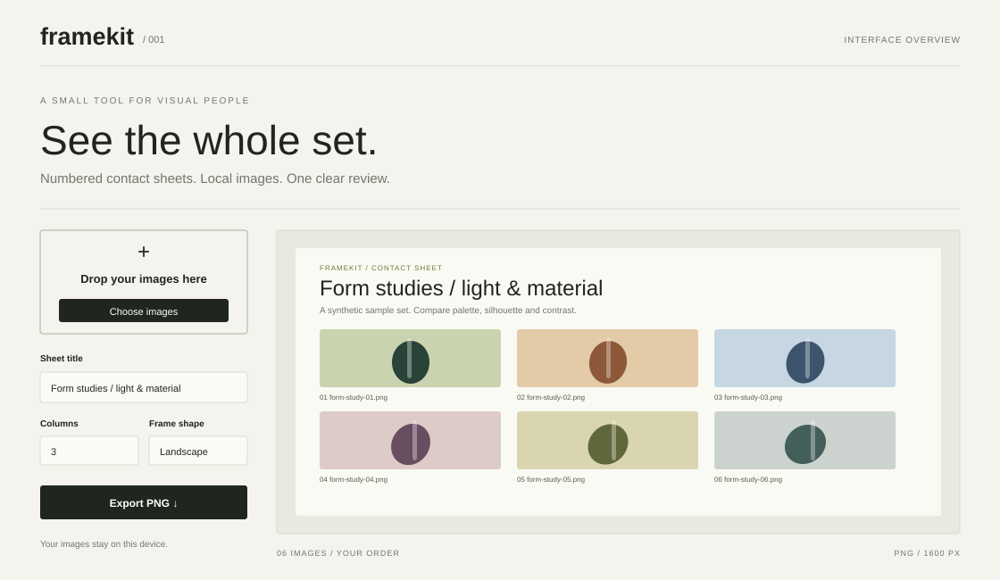

# Framekit

**See the whole set.** A small contact-sheet maker for visual exploration.

Compare generated variations, photo selects or design directions on one numbered sheet. Pick images, adjust the layout and export a PNG. Everything runs on your device.

## Try it

1. Download this repository with **Code → Download ZIP** and extract it.
2. Open **tools/framekit/index.html** in a current desktop browser. Keep `app.js` and `style.css` beside it.
3. Click **Try a sample set**, or add your own PNG, JPEG or WebP files.
4. Set the title, frame shape and captions. Use the arrows below the preview to reorder.
5. Click **Export PNG**.

No installation, account, API key, build step or server.

## What it does

- 2–5 columns; square, landscape and portrait frames.
- Full-image or cropped fit, paper and ink themes.
- Numbered filenames, a sheet title and an optional review note.
- Reorder or remove individual images without changing the originals.
- Fixed 1600 px output width; height follows the layout.

The six sample forms are drawn with Canvas. They are synthetic demo material, not an AI-generation result or a client project.

## A useful review loop

Export a sheet, share it with a collaborator and ask for feedback by frame number:

> Keep the silhouette from 02, the light from 05 and the quieter background from 01. Make one new variation before expanding the set.

You can also add the sheet to an image-capable assistant. Framekit itself does not call an AI model.

## Files

| File | Purpose |
| --- | --- |
| `index.html` | Accessible controls and page structure |
| `style.css` | Responsive interface |
| `app.js` | Image loading, local previews, ordering and PNG export |

## Limits and privacy

Up to 40 images, 20 MB and 24 megapixels per file. Loaded images are reduced to at most 2000 px on the longest side for the contact sheet. Animated files, SVG, HEIC and video are not supported. Large sets can use substantial browser memory.

There is no upload, analytics, external font or persistence. Refreshing the page clears the set. The source and author links open external sites only when clicked. Browser image decoding and color management may differ; this is a review sheet, not a color-proofing tool.

## Development

Edit the three source files and reopen `index.html`. Run `node tests/behavior.cjs` for the behavior checks. The manual verification checklist and its coverage limits are in [docs/verification.md](docs/verification.md).

Built with AI assistance for [satoshi 001](https://x.com/satoshiwhynot). Original project code is available under the [MIT license](LICENSE).
